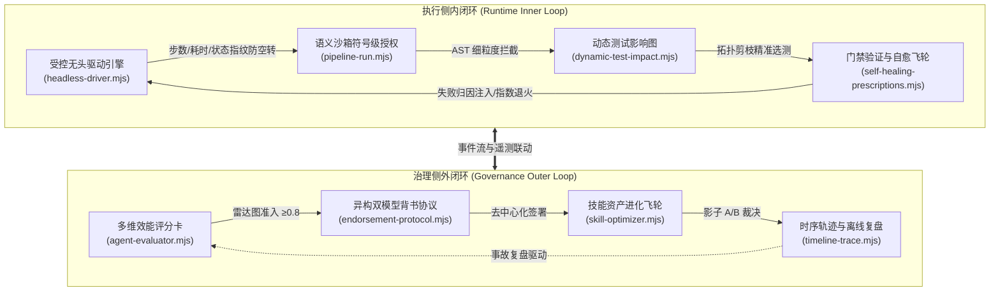

# 8 大演进机制全景架构设计文档

本文档定义 `agentic-flow-kit` 的 8 大前沿演进机制的架构拓扑、交互契约、状态机以及对标业界（特别是中兴通讯 Co-Sight Harness）的深度对比。

---

## 1. 架构总览与拓扑关系

演进机制构建了一套**双闭环自治架构**（Dual-Loop Autonomous Architecture）：
1. **执行侧内闭环**（Runtime Inner Loop）：受控无头驱动执行 $\rightarrow$ 语义沙箱符号级拦截 $\rightarrow$ 动态测试影响图增量选测 $\rightarrow$ 门禁失败知识处方自愈提炼与修复注入。
2. **治理侧外闭环**（Governance Outer Loop）：多维效能评分卡基准准入 $\rightarrow$ 异构双模型背书与对抗审计 $\rightarrow$ 技能资产影子 A/B 对抗裁决进化 $\rightarrow$ 全链路时序轨迹留痕与自包含离线复盘对质。

---

## 2. 8 大演进方向全景解构

### 方向 1：异构双模型背书与去中心化对抗审计协议 (`endorsement-protocol.mjs`)
- **设计目标**：杜绝单一模型家族同质化幻觉与单点背书伪造。
- **核心契约**：
  - 强制校验审查模型来自异构供应商（如 Claude 家族 + OpenAI / Gemini 家族）。
  - 支持多重独立背书角色（`architecture` + `security` 联合背书）。
  - 去中心化持久化分片写入 `.agents/endorsements.d/<token>.json`，杜绝单点台账文件锁并发冲突与覆写。
  - 动态注入对抗挑战向量（Adversarial Challenge Vectors），审查者必须通过挑战语义验算方可签署有效背书。

### 方向 2：语义沙箱与细粒度符号级授权 (`pipeline-run.mjs`)
- **设计目标**：超越传统文件级白名单，防止智能体在授权文件内部越权篡改未获批准的符号、API 契约或冻结逻辑。
- **核心契约**：
  - 支持在 Plan 的改动方案中声明符号级规则：
    - `symbols: [fnA, classB]`：仅允许改动声明的符号。
    - `freeze: [fnC, varD]`：严禁改动声明的冻结符号。
    - `freeze-exports: true`：严禁篡改模块的公共导出契约面。
  - 基于 AST 词法扫描对改动前后的符号做精确 diff，任何越权改动立即触发确定性门禁拦截。

### 方向 3：知识处方自愈飞轮与指数退火自适应学习 (`self-healing-prescriptions.mjs`)
- **设计目标**：消除人工重复修复同类门禁报错的负担，建立可自进化的工程知识库。
- **核心契约**：
  - 门禁失败时自动根据错误栈归因匹配知识处方库（`.agents/prescriptions.json`）。
  - 为实现工单自动注入自愈提示词与代码修复策略。
  - 自愈成功后自适应提升置信度；自愈失败或长期无命中按指数退火（Exponential Annealing）衰减降权，低于淘汰阈值自动清理，防止知识库膨胀劣化。

### 方向 4：动态测试影响图与增量选测剪枝引擎 (`dynamic-test-impact.mjs`)
- **设计目标**：解决全量回归测试耗时膨胀问题，实现秒级高精度增量选测。
- **核心契约**：
  - 多语言源码静态导入依赖解析（支持 ES Module、CommonJS、Python import 等）。
  - 逆向构建反向依赖图（Reverse Dependency Graph），使用 BFS 算法计算拓扑传导影响面。
  - 当变动触碰核心基础设施（如 package.json、公共配置等）时，自动触发 Fail-Safe 安全回退机制执行全量测试。

### 方向 5：多维效能评分卡与零依赖雷达图基准评测 (`agent-evaluator.mjs`)
- **设计目标**：对接入的异构模型进行标准化、可量化的工程能力准入把关。
- **核心契约**：
  - 涵盖 5 维加权效能评分体系：
    1. 代码规范遵从度（Syntax & Standards Conformance）
    2. 架构契约保持度（Architecture & Contract Preservation）
    3. 修复通过率（Pass-at-1 Rate）
    4. 单步执行耗时（Latency & Wall-clock Efficiency）
    5. Token 经济性（Token Consumption Ratio）
  - 标准基准评测套件驱动，纯文本生成零依赖雷达图（Radar ASCII/SVG），低于 0.8 准入阈值硬拦截上岗。

### 方向 6：技能资产自优化进化飞轮 (`skill-optimizer.mjs`)
- **设计目标**：对标中兴 Co-Sight Harness 的技能演进机制，让智能体技能资产具备自我修复与自我优化能力。
- **核心契约**：
  - 从历史自愈处方与故障记录中提炼出技能缺陷模式与改进建议。
  - 在隔离影子沙箱中基于原始技能生成候选优化版本（Candidate A/B）。
  - 双臂对抗测试运行：只有候选版本在通过率与基准指标上严格超越基线版本且零回归（Regression-Free），方可一票裁决胜出并安全应用回主干技能资产。

### 方向 7：受控无头驱动引擎与防空转状态指纹影子试跑 (`headless-driver.mjs`)
- **设计目标**：提供安全的长程自治执行容器，彻底杜绝死循环、死锁与无限空转。
- **核心契约**：
  - 三重物理防爆网：
    1. 最大步数预算上限（`maxSteps`）；
    2. 最大执行墙钟耗时熔断（`timeoutMs`）；
    3. 基于工单与文件修改哈希的状态指纹历史检测（State Fingerprint Loop Detection），连续重复状态直接判定空转熔断。
  - 支持创建与生产工作区物理隔离的影子沙箱（Shadow Workspace），长程探索与高风险试跑在沙箱中完成，测试通过后再同步产物。

### 方向 8：流水线时序轨迹与自包含离线复盘包回溯系统 (`timeline-trace.mjs`)
- **设计目标**：提供企业级全链路可观测性与审计对质能力。
- **核心契约**：
  - 标准化时序事件流追加写入 `.agents/timeline/<runId>.jsonl`，精确记录状态机跃迁、门禁起止、外部调用与人件确认。
  - 支持任意时间步的关键帧快照索引（Keyframe Indexing）与时间旅行投影回放（Time-Travel Replay）。
  - 导出自包含离线单页 HTML 复盘包（`.agents/timeline/replays/<runId>.html`），无需任何外部网络或依赖即可在浏览器中可视化审查复盘全过程。

---

## 3. 对标中兴 Co-Sight Harness 深度对比

| 维度 | 中兴通讯 Co-Sight Harness | agentic-flow-kit 演进架构 | 优势与突破点 |
|---|---|---|---|
| **运行时依赖** | 依赖重型容器化环境与外部服务端管控平台 | **零运行时依赖**，Node.js ≥22 标准库确定性执行 | 轻量化秒级启动，任意单机与 CI 均可一键即跑 |
| **执行防爆** | 依赖外部服务端监控与人工后台介入 | **确定性三维防爆**（步数 + 耗时 + 状态指纹防空转） | 进程内实时拦截死循环，杜绝无意义 Token 消耗 |
| **隔离沙箱** | Docker 容器级别隔离，启动与分发较重 | **影子工作区 + 符号级 AST 语义沙箱** | 文件系统快照 + 符号级细粒度权限控制，拦截越权变更 |
| **技能进化** | 基于集中式反馈与工程师手工调优更新技能 | **历史自愈处方提炼 + 影子 A/B 对抗裁决零回归应用** | 全自动闭环提炼，数据驱动且具有零回归保证 |
| **测试门禁** | 传统回归测试套件或粗粒度目录映射 | **拓扑传导动态测试影响图**（AST 逆向依赖解析） | 精确到模块级的增量选测，核心变动自动安全兜底全量 |
| **审查与背书** | 单一主模型审查或人工审批单 | **去中心化多模型对抗审计协议**（异构背书 + 挑战向量） | 杜绝单模型家族盲区，分片存储防篡改 |
| **事故复盘** | 依赖集中式 ELK 日志与人工提取还原 | **自包含离线 HTML 复盘包 + 时间旅行投影** | 单文件零网络复盘，精确回放每一步时序轨迹 |

---

## 4. 数据契约与存储面定义

| 存储面路径 | 读写角色 | 契约格式 | 维护说明 |
|---|---|---|---|
| `.agents/endorsements.d/<token>.json` | `endorsement-protocol.mjs` | JSON 去中心化背书分片（含模型、角色、承诺面哈希、挑战响应） | 永久留痕，防止并发锁冲突 |
| `.agents/prescriptions.json` | `self-healing-prescriptions.mjs` | JSON 数组（含规则指纹、自愈策略、置信度、成功/失败计数） | 指数退火自适应淘汰 |
| `.agents/eval-history.jsonl` | `agent-evaluator.mjs` | JSONL 评测流水（5 维雷达图评分、准入决议） | 供模型准入与代际对质查询 |
| `.agents/timeline/<runId>.jsonl` | `timeline-trace.mjs` | JSONL 规范时序事件流 | 支持时间旅行关键帧重放 |
| `.agents/timeline/replays/<runId>.html` | `timeline-trace.mjs` | 独立纯 HTML/SVG 自包含离线复盘包 | 浏览器双击直接可视化复盘 |

---

## 5. 维护纪律与退役规约

1. **确定性优先**：所有机制的核心决策算法（AST 解析、BFS 依赖图、状态哈希、指纹校验）必须保持纯确定性，不依赖不稳定的外部模型推断。
2. **安全双向兜底**：
   - 动态测试影响图在依赖解析异常或触碰基础设施时，必须无条件回退全量测试。
   - 技能资产优化在候选版本出现任何基线用例回归时，必须一票否决。
3. **退役与对账**：
   - 8 大演进机制均已登记进 `mechanism-registry.md` 与 `policy.json`。
   - 数据面机制遵循「连续 6 个有数据月零新增/零命中」启动退役重评流程；主干型机制长期现役。
